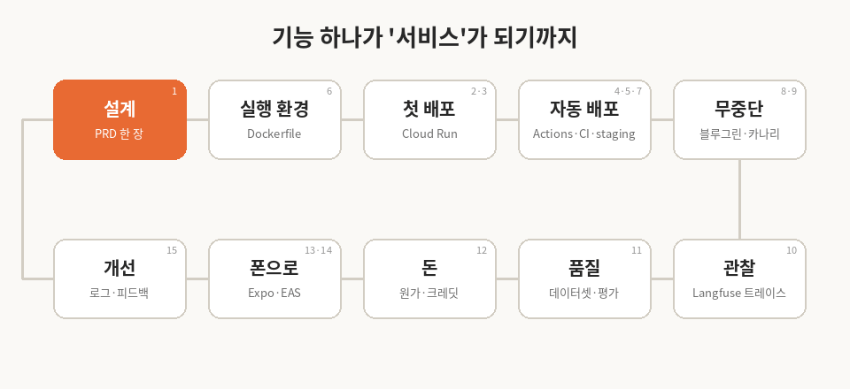
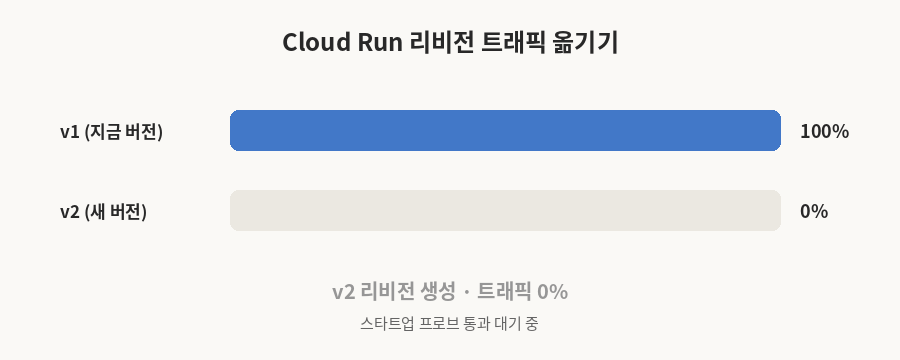
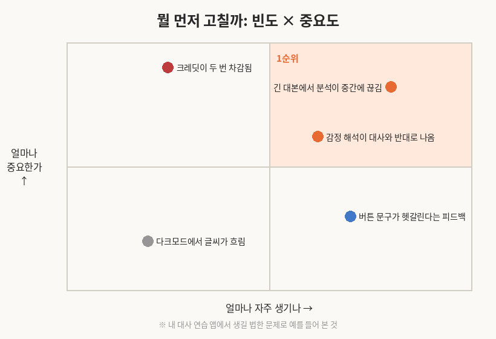

AIFFEL 에이전트 과정에서 배포·운영 파트 15개 노드를 끝냈다. 노드 이름만 보면 Cloud Run, GitHub Actions, Docker, Langfuse, Expo… 도구 이름이 줄줄이다. 그런데 다 끝내고 돌아보니 결국 한 가지 질문이었다.

**"내 노트북에서 잘 되던 기능을, 모르는 사람이 돈 내고 써도 괜찮은 상태로 만들려면 뭐가 필요한가?"**

그래서 노드 순서 말고, 내가 만들고 있는 **대사 연습 앱**을 실제로 내보낸다고 치고 흐름대로 정리해 봤다.

> 이 글에 나오는 대사 연습 앱은 실제로 돌아가고 있다. 대본을 넣으면 상대 배역을 읽어 주고, 내 대사를 듣고 채점해 준다. 설치나 가입 없이 바로 써 볼 수 있다.  
> [대사 연습 파트너 열기](https://acting-practice-160629403411.asia-northeast3.run.app/)
{: .prompt-tip }

---

## 1. 코드보다 먼저 정한 것: 누가, 어디서 쓰나

첫 노드는 코드가 하나도 없었다. 누가, 어떤 채널에서, 어떤 방식으로 쓸지 정하고 PRD 한 장으로 정리하는 게 전부였다.

내 앱에 대입해 보면 이렇다. 쓰는 사람은 오디션 준비하는 배우 지망생이고, 연습하는 곳은 책상 앞보다 지하철이나 연습실이 많다. 그럼 웹보다 결국 폰 앱이다. 이 한 줄이 13~14 노드(Expo)까지 이어진다. 처음에 대충 넘겼으면 나중에 다 뜯어고쳤을 거다.

## 2. "내 컴에선 되는데"를 없애는 법

**Dockerfile**은 "이 앱은 이 환경에서 돈다"를 글로 적어 두는 것이다. 자동으로 만들어 주는 이미지에 맡기면 빠지는 게 생긴다. 직접 적어 두니 로컬과 서버에서 같은 결과가 나왔다.

그렇게 만든 컨테이너를 **Cloud Run**에 올렸다. API 키는 코드에 넣지 않고 Secret Manager로 연결했다. 그리고 바로 AI 서비스다운 문제를 만났다.

- 긴 대본을 분석하면 답이 중간에 끊긴다 → 요청 타임아웃을 늘려야 한다
- 한동안 아무도 안 쓰다가 처음 들어오면 느리다 → 콜드 스타트
- 대화 기록이 사라진다 → 인스턴스는 언제든 새로 뜨니까, 대화는 DB에 둬야 한다

마지막 건 8노드에서 대화를 DB로 옮기면서 해결됐다. 서버는 기억하면 안 되는 존재라는 게 이때 와닿았다.

## 3. 사람이 실수해도 사용자는 모르게

배포를 손으로 하면 언젠가 사고가 난다. 그래서 단계를 하나씩 쌓았다.

| 단계 | 하는 일 | 막아 주는 것 |
|---|---|---|
| GitHub Actions + WIF | PR 머지하면 자동 배포, 키 파일 없이 내 저장소에만 권한 | 키 유출, 손 배포 실수 |
| CI 테스트 | PR마다 테스트 자동 실행 | 깨진 코드 머지 |
| staging | 사용자 전에 내가 먼저 확인 | "올리고 나서 발견" |
| 이미지 한 번 빌드 | 커밋 SHA로 이름 붙인 이미지를 staging → production 그대로 | "staging에선 됐는데?" |

여기까지 오면 마지막 고민은 **바꾸는 순간**이다. Nginx로 블루그린을 손으로 해 본 다음 Cloud Run 리비전으로 다시 해 봤는데, 원리는 같다. 새 버전을 옆에 띄우고, 준비되면 트래픽만 옮긴다.

인상 깊었던 건 **스타트업 프로브**와 **롤백**이다. 준비 안 된 버전에는 트래픽이 아예 안 가고, 문제가 생기면 다시 빌드할 필요 없이 트래픽만 이전 리비전으로 돌리면 된다.

## 4. 에러는 없는데 답이 이상할 때

LLM 서비스는 서버 로그상으로는 멀쩡한데 답이 엉뚱한 경우가 많다. 그래서 **Langfuse**로 한 턴을 트레이스로 쪼개서 본다. 사용자, 세션, 버전, 점수를 붙여 두면 "어느 단계에서 처음 이상해졌는지"가 보인다.

내 앱으로 치면 이런 상황이다. 감정 분석을 잘 하라고 프롬프트를 고쳤더니, 짧은 대본에서는 오히려 엉뚱한 답이 나온다. 한 곳을 고치면 다른 데가 깨지는 거다. 그래서 11노드에서는 실패 유형별로 **데이터셋과 평가자**를 만들고, 프롬프트를 버전으로 관리하고, 평가를 CI에 붙였다. 점수가 떨어진 변경은 배포 자체가 안 된다. 코드 테스트를 프롬프트에도 거는 셈이다.

## 5. 돈과 폰

12노드가 개인적으로 제일 현실적이었다. 대본 분석 한 건에 얼마를 받을지 감으로 정하려 했는데, Langfuse 기록으로 **건당 원가**부터 계산하는 게 순서였다.

- 원가: 분석 1건 평균 토큰 비용 (Langfuse에서 확인)
- 여기에 재시도·실패분, 무료 한도로 나가는 몫을 얹는다
- 그래야 크레딧 묶음 가격이 손해 안 보는 선에서 나온다

크레딧은 잔액 숫자 하나로 두지 않고 **원장**으로 쌓아서 서버에서만 차감한다. 결제는 토스페이먼츠 위젯을 붙이되, 금액 확인은 서버 승인으로, 중복 결제는 **멱등키**로 막는다. 결제 버튼 두 번 누르는 사람은 반드시 있다.

그다음 **Expo**로 백엔드는 그대로 두고 폰 앱을 붙였다. Expo Go로 내 폰에서 바로 돌려 보고, EAS Build로 Android 설치 파일까지 만들었다. 1노드에서 "지하철에서 쓴다"고 적어 둔 게 여기서 실제 화면이 됐다.

## 6. 그리고 다시 처음으로

마지막 노드는 출시 이후 이야기다. 로그와 피드백에서 문제를 모은 다음, 다 고치는 게 아니라 **얼마나 자주, 얼마나 중요한지**로 순서를 정한다.

여기서 하나 덧붙이고 싶은 건, "크레딧 두 번 차감" 같은 돈 문제는 자주 안 생겨도 바로 고쳐야 한다는 점이다. 빈도 표는 판단을 도와주는 도구지 정답표가 아니다.

고친 뒤에는 고치기 전과 **같은 기준**으로 비교하고, 새 대화에서도 정말 나아졌는지 다시 본다. 이게 다시 4번 단계의 평가로 이어지고, 결국 1번 설계까지 돌아간다. 흐름 그림의 화살표가 원으로 닫히는 이유다.

---

15개 노드를 하면서 제일 크게 바뀐 생각은 이거다. 예전엔 "기능이 되면 끝"이라고 생각했는데, 이제는 **되는 기능은 출발선**이다. 그 뒤에 배포, 관찰, 돈, 피드백이 붙어야 서비스가 된다. 다음은 이 흐름을 최종 프로젝트에 처음부터 깔고 시작해 볼 생각이다.

---

### 직접 써 보기

글에서 예시로 든 그 앱이다. PC든 휴대폰이든 브라우저로 열고 마이크만 허용하면 된다. 써 보고 불편한 점을 댓글로 남겨 주면, 6번에서 말한 그 '피드백'으로 소중히 쓰겠다.

- 바로 열기: [https://acting-practice-160629403411.asia-northeast3.run.app/](https://acting-practice-160629403411.asia-northeast3.run.app/)
- 휴대폰이라면 아래 QR을 찍으면 된다.

{: width="180" }
